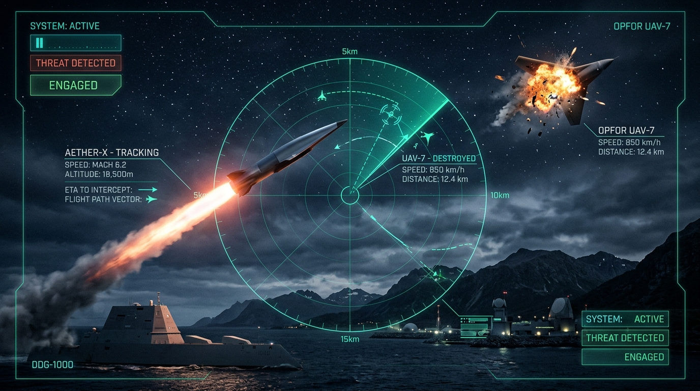
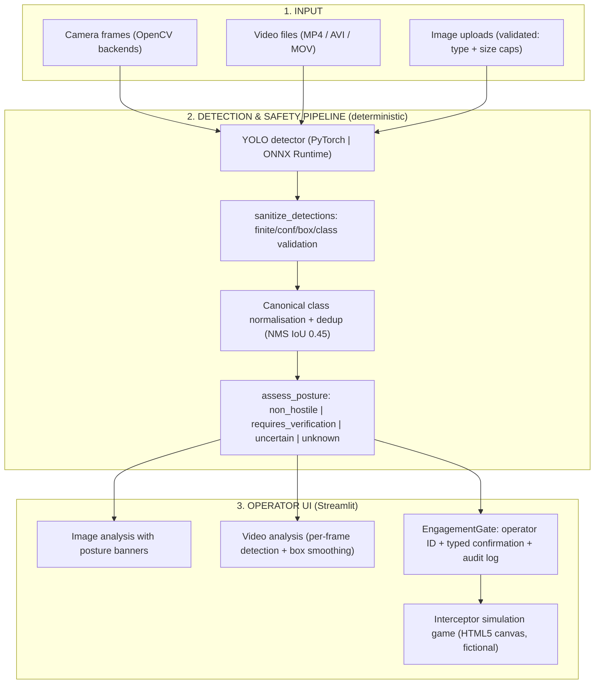

# 🛡️ AeroWatch AI: YOLO-Based Aerial Object Detection with a Safety-First Operator UI and an Interceptor Simulation Game

<p align="center">
  
</p>

<p align="center">
  <strong>YOLO object detection (Drone / Aircraft / Bird / Balloon) • Deterministic safety postures • Human-verified simulation demo • Independently benchmarked on a license-verified test set</strong>
</p>

<p align="center">
  <a href="https://github.com/0xsabry/AeroWatchAI/actions/workflows/ci.yml"></a>
  <a href="https://github.com/0xsabry/AeroWatchAI/blob/main/LICENSE"></a>
  
  
  
</p>

---

<!-- Structured data for search engines. Every statement below is kept
     consistent with the measured results in this README and the audit
     documents under docs/. -->
<script type="application/ld+json">
{
  "@context": "https://schema.org",
  "@type": "SoftwareApplication",
  "name": "AeroWatch AI",
  "applicationCategory": "DeveloperApplication",
  "operatingSystem": "Windows 10, Windows 11, Linux",
  "description": "Open-source research prototype that detects drones, aircraft, birds and balloons in images and video using YOLO object-detection models, presents detections with deterministic safety postures that never treat a model classification as a confirmed threat, and includes a fictional browser-based interceptor simulation game. It does not control any real weapon, sensor or fire-control system.",
  "author": {
    "@type": "Person",
    "name": "Eng. Mohamed Sabry"
  },
  "license": "https://opensource.org/licenses/MIT",
  "offers": {
    "@type": "Offer",
    "price": "0.00",
    "priceCurrency": "USD"
  },
  "keywords": "aerial object detection, drone detection, computer vision, yolo, pytorch, onnx, object detection benchmark, simulation game"
}
</script>

> **📏 Measured results (read first):** On the project's license-verified,
> independent test set (Phase 5, `data/verified_v1/`, never used for
> training or tuning), the default checkpoint `aerowatch_v7_balanced.pt`
> scores **mAP50 0.497 / mAP50-95 0.363**, precision 0.784 / recall 0.453 /
> F1 0.574 at confidence 0.25 — see the benchmark section below for
> per-class figures and limitations. An earlier 30-image project test set
> produced higher figures (mAP50 0.968) but is **exploratory and
> potentially contaminated** (its sources overlap the training sources),
> so it is reported only as an upper bound. The interceptor is a
> browser-canvas **simulation game**: no kill probability has been
> measured against any real system, and nothing in this project controls
> real hardware. Licensing is **unresolved**: the code is labelled MIT
> but the Ultralytics dependency is AGPL-3.0 — see
> [docs/LICENSE_AUDIT.md](docs/LICENSE_AUDIT.md) before distributing
> anything. Full audits: [docs/AI_ENGINEERING.md](docs/AI_ENGINEERING.md),
> [docs/CV_QUALITY.md](docs/CV_QUALITY.md),
> [docs/VERIFIED_DATASET_PHASE5.md](docs/VERIFIED_DATASET_PHASE5.md),
> [docs/PRODUCT_READINESS.md](docs/PRODUCT_READINESS.md),
> [docs/LLM_PROMPT_AUDIT_PHASE6.md](docs/LLM_PROMPT_AUDIT_PHASE6.md).

## 📖 Table of Contents
1. [What is AeroWatch AI?](#-what-is-aerowatch-ai)
2. [Key Capabilities — and Explicit Non-Capabilities](#-key-capabilities--and-explicit-non-capabilities)
3. [System Architecture](#️-system-architecture)
4. [Detection Models & Measured Benchmarks](#-detection-models--measured-benchmarks)
5. [The Interceptor Simulation Game](#-the-interceptor-simulation-game)
6. [Dashboard Modules](#️-dashboard-modules)
7. [Quick Start & Installation](#️-quick-start--installation)
8. [Frequently Asked Questions](#-frequently-asked-questions)
9. [Repository Map](#-repository-map)
10. [Hardware & Performance Notes](#️-hardware--performance-notes)
11. [Citation](#-citation)
12. [License & Maintainer](#-license--maintainer)

---

## 🎯 What is AeroWatch AI?

> **AeroWatch AI** is an open-source **research prototype** for aerial
> object detection. A YOLO detector (PyTorch or ONNX Runtime backends)
> detects four civilian classes — **Drone, Aircraft, Bird, Balloon** — in
> uploaded images, videos, and camera frames. Detections pass through
> deterministic validation, canonical class normalisation and
> de-duplication, and are presented with a **safety posture** computed by
> plain code (`ai_safety.assess_posture`): civilian classes are
> non-hostile at any confidence, and even a confident drone detection
> only ever means *"operator verification required"*. A model
> classification is never presented as a confirmed threat, an identity,
> or an authorisation. The project also includes a fictional HTML5
> **interceptor simulation game** for demonstration; opening it requires
> an operator ID and a typed confirmation, and every launch is written
> to a local audit log.

There is **no LLM, no prompt layer, and no external AI API** in this
project (verified in Phase 6 and enforced by
`tests/test_llm_boundary.py`). The application does **not** implement
persistent object tracking: video analysis is per-frame detection plus
bounding-box smoothing. (One offline evaluation utility,
`evaluate_videos.py`, uses Ultralytics' built-in tracker to render
annotated test videos; the application itself does not track objects.)

---

## ⚡ Key Capabilities — and Explicit Non-Capabilities

**What it does**

* **Multi-class aerial detection:** YOLO checkpoints for Drone /
  Aircraft / Bird / Balloon, with a COCO baseline for comparison;
  PyTorch and ONNX Runtime backends with a tested parity gate.
* **Deterministic safety layer:** malformed model output (NaN / infinite
  / out-of-range confidence or boxes, undeclared classes) is validated
  and dropped with recorded reasons; duplicate canonical detections are
  merged (NMS IoU 0.45 + canonical de-duplication).
* **Honest presentation:** every detection is labelled an unverified
  model prediction; confidence is a detector score, not a certainty or
  a probability of hostility (measured calibration error ECE ≈ 0.14 on
  the independent test set).
* **Human-gated simulation demo:** the interceptor game opens only after
  an operator ID + typed `I VERIFY` confirmation, audit-logged locally.
* **Reproducible evaluation:** COCO-style benchmark harness, a contract
  evaluation suite (19 cases), and a license-verified dataset with
  frozen, leakage-audited splits (`data/verified_v1/`).

**What it does not do**

* ❌ Control, aim, or simulate-for-real any weapon or hardware.
* ❌ Determine hostility, intent, identity, ownership, or payload of
  anything it detects.
* ❌ Track objects persistently in the application (no ByteTrack, no
  Kalman filter, no track IDs in `app.py` / `video_processor.py`).
* ❌ Guarantee any accuracy, detection rate, or interception outcome.
* ❌ Operate autonomously: there is no auto-engagement path of any kind;
  `confirmed_hostile` and `auto_engage_allowed` are hard-coded `False`
  in `ai_safety.py`.

---

## 🏗️ System Architecture



---

## 🧠 Detection Models & Measured Benchmarks

### Independent, license-verified test set (Phase 5 — the headline figures)

Dataset: `data/verified_v1/` — 134 Wikimedia Commons images (CC0 / public
domain / CC BY / CC BY-SA only, per-image provenance in its
`MANIFEST.json`), split into train / validation / a **frozen independent
test set** (46 images, 64 ground-truth boxes, plus 15 negative images)
that was never used for training, augmentation, threshold selection, or
tuning. Benchmark: `evaluation/model_benchmark.py` at the adopted
operating configuration (imgsz 640, NMS IoU 0.45, canonical dedup).

| Checkpoint | mAP50 | mAP50-95 | Precision @0.25 | Recall @0.25 | F1 @0.25 | FP | FN | ECE |
| :--- | :---: | :---: | :---: | :---: | :---: | :---: | :---: | :---: |
| **`aerowatch_v7_balanced.pt` (default)** | **0.497** | **0.363** | **0.784** | **0.453** | **0.574** | 8 | 35 | 0.142 |

Per-class AP50 (v7, independent test): **Aircraft 0.785** (recall 0.833),
**Drone 0.537** (recall 0.429, precision 1.000 at the operating point),
**Bird 0.515** (recall 0.500), **Balloon 0.151** (recall 0.125 — the
model is weak on balloons outside its training distribution). Mean CPU
inference latency in the (shared, CPU-only) audit sandbox was ~146 ms
per image at 640 px; treat this as an environment-specific figure, not
a hardware promise.

**Limitations, plainly:** the set is small (per-class test ground truth
12–22 boxes, so differences under ~0.05 mAP are noise), and Commons
photography skews to close-up / ground / festival scenes rather than
distant surveillance views. These figures measure generalisation to
real-world photos; they are not a certification of anything.

Two fine-tuned candidates were trained on the verified training split
and evaluated on the same frozen test set (Phase 5): a clean-base
candidate reached mAP50 0.551 but with 127 false positives (unusable at
the operating point), and a gentle fine-tune of v7 reached mAP50 0.584
with much better balloon detection (AP50 0.824) and calibration
(ECE 0.101) — but **regressed on Drone AP50 (0.354 vs 0.537)**, so
**v7 remains the default checkpoint**. Candidate weights were not
distributed; training scripts and run records are in the repository.

### Earlier project test set (exploratory — upper bound only)

On the project's original 30-image test set, v7 measured mAP50 0.968 /
mAP50-95 0.689 (Phase 2). That set's sources overlap the training
sources, so it is formally **exploratory / potentially contaminated**
(`tests/artifacts/EVAL_SET_STATUS.md`) and must not be quoted as the
model's accuracy. Figures published in older versions of this README
(84.6% mAP@50, 96.7% drone precision, 3.0 ms latency) came from
undocumented evaluations and are **withdrawn**.

### Detection classes

* **`Drone`** — multirotor UAVs. Independent-test AP50 0.537.
* **`Aircraft`** — fixed-wing aircraft and airliners. AP50 0.785. (The
  checkpoint also declares a `military_jet` raw class; it is normalised
  to `Aircraft` and de-duplicated against it.)
* **`Bird`** — birds in flight. AP50 0.515.
* **`Balloon`** — hot-air balloons. AP50 0.151 (weak; see limitations).

---

## 🚀 The Interceptor Simulation Game

`interceptor_sim.py` generates a self-contained HTML5 canvas **game**
in which a fictional interceptor steers toward a moving target using
proportional-navigation-style math in **pixels per second**:

* **Guidance (in-game):** augmented proportional navigation,
  $\vec{a}_m = N \cdot V_c \cdot \dot{\vec{\lambda}} + \frac{N}{2} \cdot
  \vec{a}_{t,\perp}$ with navigation gain $N = 4.5$, a lead-point aim
  projection $\vec{R}_{\text{aim}} = \vec{r}_t + \vec{v}_t t_{\text{lead}}
  + \frac{1}{2} \vec{a}_t t_{\text{lead}}^2$, a swept closest-approach
  check to prevent frame tunnelling, and a proximity rule that ends the
  run when the game distance falls below a pixel threshold.
* **Presentation:** game HUD figures (speeds labelled "Mach", energies,
  a "SIM Pk (GAME SCORE)") are **fiction parameters of the game**, not
  measurements. The page carries a "Simulation only" banner, results are
  labelled "Simulated intercept … (game outcome — not a real-world
  result or certification)", and the scenario suite reports a
  *simulation success rate*, never a kill probability.
* **Access:** launching the game from a live drone detection requires
  the `EngagementGate` (operator ID + typed confirmation + audit log).
  The game receives only an allowlisted target label, embedded as a
  JSON literal (injection-tested).

`video_interceptor_testbench.py` runs the same simulation logic over
scenario videos overlaid on detector output, producing H.264 clips for
demonstration.

---

## 🖥️ Dashboard Modules

The Streamlit dashboard (`app.py`) runs at `http://localhost:8501/`:

1. **Dashboard:** an overview computed from the local detection
   history (sessions, detections, class mix, confidence distribution,
   model/runtime) — empty until you process something; nothing is
   fabricated.
2. **Optical Image Analysis:** upload or pick a sample image; detections
   are drawn with posture banners (civilian = non-hostile; drone =
   operator verification required), a per-prediction explainability
   panel, and automatic recording into local history.
3. **Detection History:** searchable past sessions with filters, human
   verification marking, retention/deletion controls, and CSV/JSON/
   Markdown exports (all labelled as unverified predictions). History
   stores metadata only — never your images or videos.
4. **Analytics & Reports:** history charts, per-session comparisons,
   human-review tallies, and the documented benchmark results.
5. **Interceptor Simulation:** the radar/dogfight game and the video
   testbench described above, both clearly labelled as simulation.
6. **Real-Time Sensor Stream:** camera frames analysed per frame.
7. **Video Flight Intelligence:** per-frame detection over video with
   bounding-box smoothing and H.264 export. Two bundled presets are
   **AI-generated demonstration videos** (Gemini-generated) and are
   labelled as synthetic footage in the UI — they are not real camera
   recordings.
8. **Neural Architecture & Weights:** checkpoint inventory and metadata.
9. **Hardware & Latency Benchmarks:** project-reported pipeline figures
   (labelled in the UI as not independently audited).
10. **System & Device Diagnostics:** local environment and dataset
    diagnostics.

**Deployment note:** the app has no authentication. Run it locally, or
internally behind an authenticating proxy/VPN only — see
[docs/PRODUCT_READINESS.md](docs/PRODUCT_READINESS.md).

---

## 🛠️ Quick Start & Installation

### Prerequisites
* **Operating System:** Windows 10/11 (64-bit) or Linux
* **Python:** 3.12 (the pinned, verified environment; see
  `requirements-lock.txt`)
* **GPU:** optional — CPU inference works; CUDA torch builds can be
  installed per [docs/RUNTIME_PHASE4.md](docs/RUNTIME_PHASE4.md)
* **FFmpeg:** on PATH or resolved via bundled `imageio-ffmpeg`

### Install & run

```bash
git clone https://github.com/0xsabry/AeroWatchAI.git
cd AeroWatchAI

python -m venv .venv
.venv\Scripts\Activate.ps1   # Linux/macOS: source .venv/bin/activate

pip install --upgrade pip
pip install -r requirements.txt --extra-index-url https://download.pytorch.org/whl/cpu

streamlit run app.py
```

Open **`http://localhost:8501/`**.

### Run the test & evaluation suites

```bash
pytest tests/ -v                                   # full test suite
python evaluation/run_evaluation.py                # 19-case AI contract evaluation
python evaluation/model_benchmark.py --dataset-dir data/verified_v1/test \
    --model weights/aerowatch_v7_balanced.pt       # independent-set benchmark
bash scripts/ci_checks.sh                          # local mirror of all CI gates
```

---

## ❓ Frequently Asked Questions

### Q1: Is AeroWatch AI a real counter-drone system?
**No.** It is a research prototype: a YOLO detector with a careful
safety/presentation layer, plus a fictional simulation game. It is not
connected to any weapon, military sensor, or operational system, and it
must not be relied on for the protection of anything.

### Q2: How accurate is the detector, honestly?
On the independent, license-verified test set: **mAP50 0.497** overall,
with Drone AP50 0.537 and recall 0.453 at the default operating point —
it misses more than half of the ground-truth objects on that set, and
it is weak on balloons (AP50 0.151). See the benchmark section for the
full table and limitations. Higher figures from the older project test
set are contaminated upper bounds, not accuracy claims.

### Q3: Does a detection mean something is hostile?
**Never.** A detection is an unverified model prediction. Civilian
classes (Aircraft, Bird, Balloon) are presented as non-hostile at any
confidence; a drone detection asks a human to verify visually. The code
cannot produce a "confirmed hostile" state at all
(`ai_safety.assess_posture`).

### Q4: Does it track objects across frames?
Not in the application. Video analysis runs detection per frame and
smooths bounding boxes for display stability; there are no track IDs,
no ByteTrack, and no Kalman filter in `app.py` or `video_processor.py`.
(The offline `evaluate_videos.py` utility uses Ultralytics' built-in
tracker when rendering annotated evaluation videos.)

### Q5: Does it use an LLM or any AI API?
No. There are no prompts, no LLM providers, and no external AI calls;
this is enforced by an automated boundary test
(`tests/test_llm_boundary.py`, Phase 6).

### Q6: Can I try the interceptor game?
Yes — launch the dashboard, open **Interceptor Simulation**, and play.
If you arrive from a live drone detection, the app asks for an operator
ID and a typed confirmation first, and logs the launch locally. All
outcomes are game scores.

---

## 📁 Repository Map

```
AeroWatchAI/
├── app.py                              # Streamlit dashboard (detection UI + simulation pages)
├── ai_safety.py                        # Deterministic safety layer: validation, postures, gate
├── model_manager.py                    # Checkpoint loading, label normalisation, filtering/dedup
├── onnx_backend.py                     # Optional ONNX Runtime backend (parity-tested)
├── interceptor_sim.py                  # HTML5 canvas interceptor simulation game
├── video_interceptor_testbench.py      # Simulated interception overlaid on scenario videos
├── video_processor.py                  # Per-frame video detection + box smoothing + H.264 export
├── camera_manager.py                   # Camera capture (DirectShow/MSMF/V4L2)
├── predict_image.py                    # CLI single-image detection with posture output
├── evaluate_videos.py                  # Offline annotated-video evaluator (Ultralytics tracker)
├── diagnostics.py                      # System/dataset diagnostics
├── evaluation/                         # Benchmark, contract evaluation, dataset & license audits
├── data/verified_v1/                   # License-verified dataset with frozen independent test split
├── docs/                               # Phase audit documents (AI engineering, CV quality,
│                                       #   provenance, licensing, readiness, runtime, LLM audit)
├── weights/                            # YOLO checkpoints (default: aerowatch_v7_balanced.pt)
├── tests/                              # PyTest suite + benchmark artifacts
├── CITATION.cff                        # Citation metadata
├── SECURITY.md                         # Security policy & AI safety boundaries
└── README.md                           # This file
```

---

## ⚙️ Hardware & Performance Notes

* **Verified environment:** Python 3.12 with the pinned dependencies in
  `requirements-lock.txt`; the full suite (100+ tests), the contract
  evaluation, and all benchmarks in the audit documents were run in a
  CPU-only sandbox.
* **Measured CPU latency:** ~146 ms mean per image (640 px, v7, shared
  sandbox CPU) on the independent test set — environment-specific.
* **GPU figures:** earlier project artifacts report FP16 latencies on an
  RTX 3050 laptop GPU, but GPU performance was **not independently
  measured** in the audit phases. Run
  `python evaluation/hardware_benchmark.py` on your own hardware for
  real numbers.
* **Video encoding:** `imageio-ffmpeg` H.264 (`yuv420p`, faststart),
  verified by post-write reopening checks.

---

## 📄 Citation

```bibtex
@software{Sabry_AeroWatchAI_2026,
  author = {Sabry, Mohamed},
  title = {{AeroWatch AI: YOLO-Based Aerial Object Detection with a Deterministic Safety Layer and an Interceptor Simulation Game}},
  year = {2026},
  url = {https://github.com/0xsabry/AeroWatchAI},
  publisher = {GitHub}
}
```

See also [CITATION.cff](CITATION.cff).

---

## 📜 License & Maintainer

The project code is released under the **[MIT License](LICENSE)**.
**Licensing caveat:** the Ultralytics dependency is AGPL-3.0, and the
training-data provenance of the shipped checkpoints is only partially
verifiable — read [docs/LICENSE_AUDIT.md](docs/LICENSE_AUDIT.md) before
distributing the code or any checkpoint.

Maintained by **Eng. Mohamed Sabry** as an open research prototype in
aerial object detection and AI safety presentation.

<p align="center">
  <strong>AeroWatch AI — measured claims, honest labels, human-verified AI.</strong>
</p>
