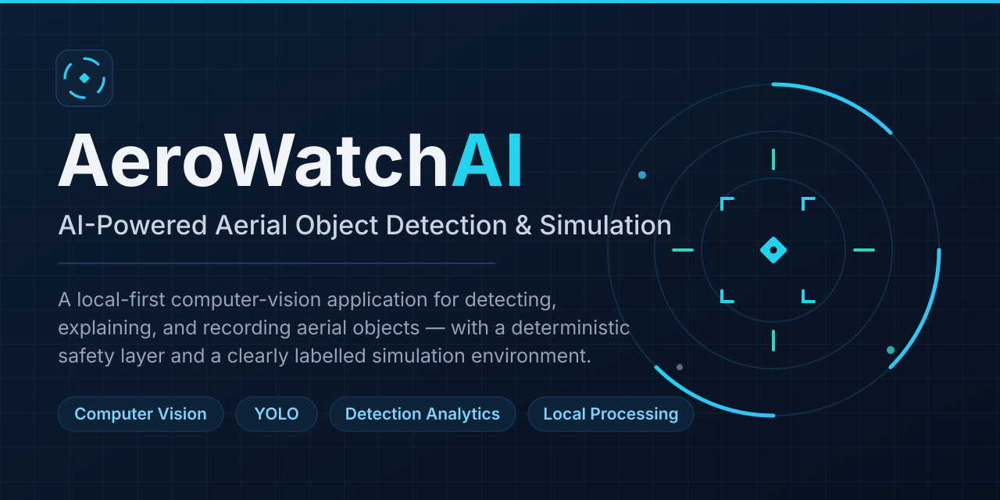
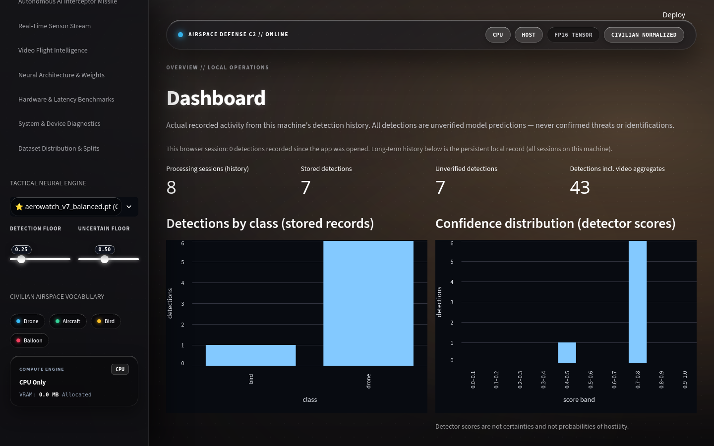
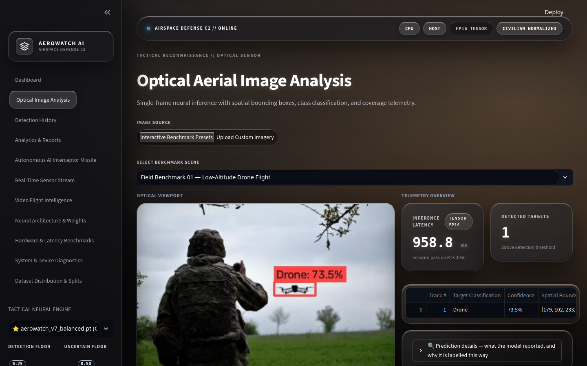
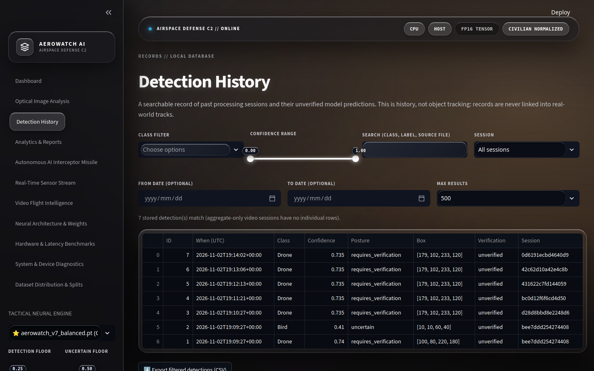
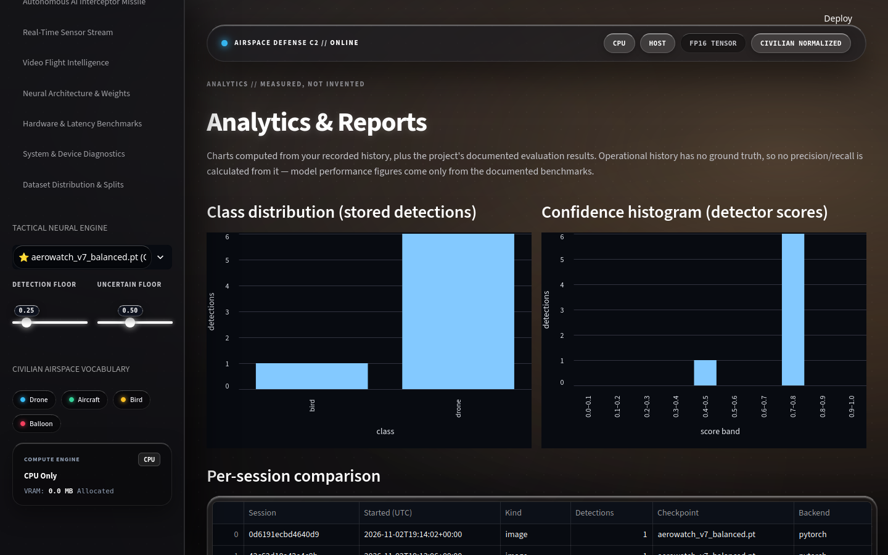
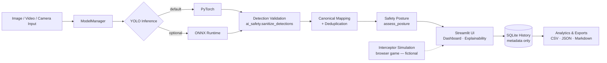

<div align="center">



# AeroWatchAI

**AI-powered aerial object detection & simulation — local-first, safety-gated, and honestly measured.**

[](https://www.python.org/)
[](https://pytorch.org/)
[](https://onnxruntime.ai/)
[](https://streamlit.io/)
[](#-quick-start)
[](#-license-status)

[Quick Start](#-quick-start) · [Screenshots](#-screenshots) · [Architecture](#-architecture) · [Measured Performance](#-measured-performance) · [Documentation](docs/README.md) · [Final Release Guide](docs/FINAL_RELEASE_GUIDE.md) · [العربية](README_AR.md)

</div>

<script type="application/ld+json">
{
  "@context": "https://schema.org",
  "@type": "SoftwareApplication",
  "name": "AeroWatch AI",
  "applicationCategory": "DeveloperApplication",
  "operatingSystem": "Windows 10, Windows 11, Linux",
  "description": "Open-source research prototype that detects drones, aircraft, birds and balloons in images and video using YOLO object-detection models, presents detections with deterministic safety postures that never treat a model classification as a confirmed threat, and includes a fictional browser-based interceptor simulation game. It does not control any real weapon, sensor or fire-control system.",
  "author": {
    "@type": "Person",
    "name": "Eng. Mohamed Sabry"
  },
  "offers": {
    "@type": "Offer",
    "price": "0.00",
    "priceCurrency": "USD"
  },
  "keywords": "aerial object detection, drone detection, computer vision, yolo, pytorch, onnx, object detection benchmark, simulation game"
}
</script>

---

## What is AeroWatchAI?

AeroWatchAI is a **local-first computer-vision application** that detects aerial objects — **Drone, Aircraft, Bird, Balloon** — in images, videos, and camera frames, explains every prediction, and records a searchable local history of what it processed.

It is built around three engineering commitments:

1. **A deterministic AI-safety layer.** Raw model output never reaches the user unfiltered. Every detection is validated, canonically mapped, deduplicated, and assigned a *posture* by deterministic code (`ai_safety.py`): civilian classes are non-hostile at any confidence, a confident drone means *operator verification required* — never a confirmed threat — and automatic engagement is hard-coded off.
2. **Honest measurement.** The headline model was re-evaluated on a small, license-verified, independently built test set (Phase 5). The results (mAP50 **0.497**) replaced the project's earlier marketing figures, which are **withdrawn** — they matched no reproducible measurement.
3. **Local-first operation.** No cloud, no external AI APIs, **no LLM anywhere in the system**. History stores metadata only — never your images, videos, or camera frames.

The application also contains a **fictional browser simulation game** (an interceptor mini-game). It is a separate component, labelled as simulation everywhere, and is not connected to any real sensor, weapon, or fire-control system.

## ✨ Feature highlights

| Area | What is implemented |
|---|---|
| **Detection** | YOLO-based detection (PyTorch default, ONNX Runtime optional) over 4 canonical classes, with canonical mapping + cross-class deduplication |
| **Safety** | Deterministic validation & posture engine; NaN/out-of-range rejection; upload validation; operator gate (ID + typed phrase + audit log) for the simulation's engagement path |
| **Workflows** | Image analysis with per-prediction explainability · video processing with progress and aggregate summaries · camera sessions with start/stop lifecycle and recorded aggregates |
| **History** | Persistent SQLite detection history: search, class/confidence/date filters, human verification marking, retention & pruning, backup/restore, delete controls |
| **Analytics** | Dashboard + analytics computed only from real recorded history; documented benchmark results shown separately from operational data |
| **Exports** | CSV (formula-injection safe), JSON, and Markdown session reports — all carrying the unverified-prediction disclaimer |
| **Operations** | Hardware diagnostics, one-command release validation, offline mode (`AEROWATCH_OFFLINE=1`), Windows setup/launch scripts |

## 📸 Screenshots

*Real application captures from the Phase 9 browser QA (Playwright/Firefox), recorded in `docs/qa_phase9/`. Data shown is QA seed data plus live detections made during the session.*

<table>
<tr>
<td width="50%"><br><sub><b>Dashboard</b> — totals, class mix, and confidence distribution from local history</sub></td>
<td width="50%"><br><sub><b>Image analysis</b> — detection, posture, and telemetry overview</sub></td>
</tr>
<tr>
<td width="50%"><br><sub><b>Detection history</b> — filters, verification status, exports</sub></td>
<td width="50%"><br><sub><b>Analytics &amp; reports</b> — history charts and documented model performance</sub></td>
</tr>
</table>

## 🧭 Architecture



Component responsibilities and the full data-flow are documented in [docs/ARCHITECTURE.md](docs/ARCHITECTURE.md) and [docs/AI_ENGINEERING.md](docs/AI_ENGINEERING.md).

**What the application does not do:** it does **not** implement persistent object tracking (no track IDs; video uses per-frame detection with bounding-box smoothing), does not estimate distances, and does not control any real hardware beyond reading a local camera.

## 🛠️ Technology stack

- **Language/runtime:** Python 3.12, pinned dependency lockfile (`requirements-lock.txt`)
- **Detection:** Ultralytics YOLO (see licensing note), PyTorch 2.5.1, ONNX Runtime (optional backend)
- **Interface:** Streamlit, OpenCV, Pillow
- **Storage:** SQLite (local detection history)
- **Verification:** pytest (169 tests), contract evaluation harness, local CI mirror (`scripts/ci_checks.sh`), Playwright browser QA

## 🚀 Quick Start

### Windows (recommended path)

```powershell
powershell -ExecutionPolicy Bypass -File setup_windows.ps1   # once: checks Python, creates .venv, installs pinned deps, runs preflight
powershell -ExecutionPolicy Bypass -File launch_windows.ps1  # every run → http://localhost:8501
powershell -ExecutionPolicy Bypass -File launch_windows.ps1 -Offline   # optional: outbound network blocked
```

The setup installs the **CPU** build by default and never downloads model weights. With an NVIDIA GPU it *prints* the CUDA swap command for you to run deliberately — nothing GPU-specific is installed silently. Full instructions, GPU path, and troubleshooting: [docs/WINDOWS_GUIDE.md](docs/WINDOWS_GUIDE.md).

### Any platform

```bash
python -m venv .venv && source .venv/bin/activate   # Windows: .venv\Scripts\Activate.ps1
pip install -r requirements-lock.txt --extra-index-url https://download.pytorch.org/whl/cpu
python preflight.py        # environment + checkpoint integrity gate
streamlit run app.py       # http://localhost:8501
```

### Validate a release

```powershell
powershell -ExecutionPolicy Bypass -File validate_release.ps1            # quick validation
powershell -ExecutionPolicy Bypass -File validate_release.ps1 -Full -Camera -Offline   # full owner acceptance
```

## 📏 Measured performance

**Independent, license-verified test set** (Phase 5 — 46 images / 64 ground-truth boxes from Wikimedia Commons, frozen before any tuning; `evaluation/results/bench_v7_independent_test.json`):

| Metric | Value |
|---|---|
| mAP50 | **0.497** |
| mAP50-95 | **0.363** |
| Precision @ conf 0.25 | 0.784 |
| Recall @ conf 0.25 | 0.453 |
| F1 @ conf 0.25 | 0.574 |
| Calibration error (ECE) | ≈ 0.14 |

Per-class AP50: **Aircraft 0.785 · Drone 0.537 · Bird 0.515 · Balloon 0.151** — balloon detection is a known weakness. These results are **exploratory**: the set is small (per-class ground truth of 12–22 boxes, so differences under ~0.05 mAP are noise) and Commons imagery skews toward close-up, ground, and festival scenes. They do not establish broad real-world generalisation. Earlier headline figures for this project are **withdrawn**. Full methodology: [docs/VERIFIED_DATASET_PHASE5.md](docs/VERIFIED_DATASET_PHASE5.md); provenance: [docs/DATASET_PROVENANCE.md](docs/DATASET_PROVENANCE.md).

## 🛡️ Safety and privacy

- Every prediction is an **unverified model output**; detector scores are not certainties and not probabilities of hostility.
- Civilian classes (Aircraft, Bird, Balloon) are **never** classified hostile by the safety layer, at any confidence.
- The interceptor is a **fictional simulation game**; the application does not control real weapons, sensors, or aircraft.
- **No LLM** is integrated anywhere (enforced by a regression test); no data leaves the machine; history stores metadata only.
- The app has **no authentication** — run it locally, or behind an authenticating proxy/VPN. Public deployment is not approved (`docs/PRODUCT_READINESS.md`).

## 📦 Project status

| | |
|---|---|
| **Technical verification** | ✅ TECHNICALLY VERIFIED — 169 tests, contract evaluation 19/19, real-browser QA, clean-room install |
| **Owner validation** | ⏳ PENDING — RTX 3050 benchmark, physical-camera run, and first PowerShell execution happen on the owner's machine |
| **Distribution** | ⛔ DISTRIBUTION NOT CLEARED — licensing unresolved (below) |

Known limitations: weak balloon detection, no persistent tracking, small verified dataset, single-user local storage. Release freeze details: [docs/FINAL_RELEASE_GUIDE.md](docs/FINAL_RELEASE_GUIDE.md) · [docs/RELEASE_MANIFEST.json](docs/RELEASE_MANIFEST.json).

## ⚖️ License status

**Unresolved — read before using or redistributing.** The repository carries an MIT `LICENSE` file, but the detection stack (Ultralytics) declares **AGPL-3.0** in its own metadata, and the default checkpoint was trained on data with unverified licences. No MIT badge is displayed because the combined licensing picture is not settled. Routes and implications: [docs/LICENSING_DECISION.md](docs/LICENSING_DECISION.md) · evidence: [docs/LICENSE_AUDIT.md](docs/LICENSE_AUDIT.md).

## 📚 Documentation

- **Getting started:** [Windows Guide](docs/WINDOWS_GUIDE.md) · [Final Release Guide](docs/FINAL_RELEASE_GUIDE.md)
- **Architecture & AI:** [Architecture](docs/ARCHITECTURE.md) · [AI Engineering](docs/AI_ENGINEERING.md) · [Documentation index](docs/README.md)
- **Evaluation:** [Verified Dataset (Phase 5)](docs/VERIFIED_DATASET_PHASE5.md) · [CV Quality](docs/CV_QUALITY.md) · [Dataset Provenance](docs/DATASET_PROVENANCE.md)
- **Runtime:** [Runtime & ONNX (Phase 4)](docs/RUNTIME_PHASE4.md) · [Product Readiness](docs/PRODUCT_READINESS.md)
- **Licensing & security:** [Licensing Decision](docs/LICENSING_DECISION.md) · [License Audit](docs/LICENSE_AUDIT.md) · [Security](SECURITY.md)

## 🤝 Contributing

See [CONTRIBUTING.md](CONTRIBUTING.md) — environment setup, the test battery, and the non-negotiable AI-safety and dataset-licensing rules.

---

<div align="center">
<sub><b>AeroWatchAI</b> · Local-first aerial object detection & simulation · <a href="docs/README.md">Documentation</a> · <a href="https://github.com/0xsabry/AeroWatchAI">Repository</a><br>
License status: unresolved (see above) — no commercial clearance is claimed. Predictions are unverified model outputs.</sub>
</div>
