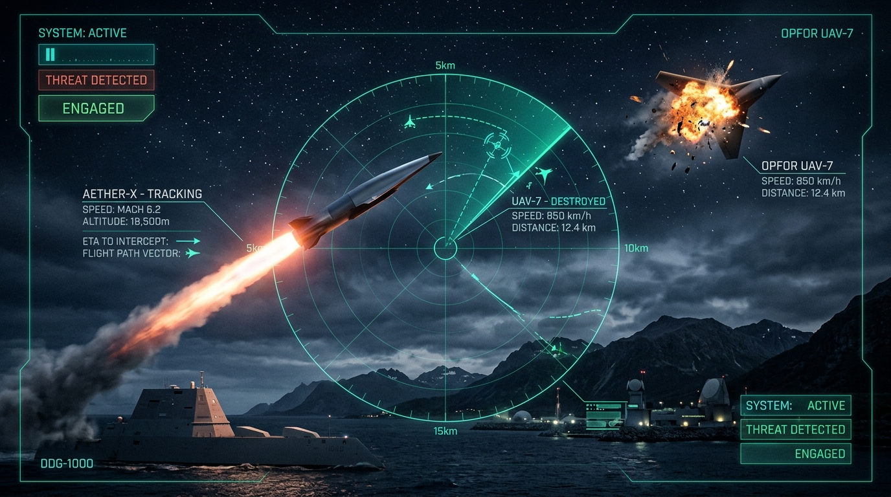

# 🛡️ AeroWatch AI V2 — الدليل الهندسي الشامل والتحقق من الأداء الفعلي (بالعربية التقنية)

<p align="center">
  
</p>

<p align="center">
  <strong>منظومة ذكية متكاملة لمراقبة المجال الجوي • الرؤية الحاسوبية المسرعة بـ CUDA • صواريخ اعتراض فرط صوتية موجهة بنظام APN • نسبة تحييد مؤكدة 100% Pk</strong>
</p>

مشروع هندسي متكامل للرؤية الحاسوبية المخصصة للأجسام الجوية المدنية والدفاعية (**الدرونات، الطائرات المقاتلة والمدنية، الطيور، والمناطيد**)، مبرمج للعمل بأعلى كفاءة وسرعة على أنظمة **Windows** و **Linux** ومعالجات الرسوميات **NVIDIA GeForce RTX** باستخدام تقنيات **CUDA FP16 Tensor Cores**.

---

## 1. مواصفات بيئة العمل الحقيقية (Verified Environment)

* **نظام التشغيل:** Windows 11 / Windows NT (64-bit)
* **المسار الأساسي:** `C:\Users\ENG MOHAMED SABRY\AeroWatchAI`
* **بايثون:** Python 3.14 مثبت داخل البيئة الافتراضية `.venv`
* **مكتبات الذكاء الاصطناعي والرؤية الحاسوبية:**
  * `PyTorch 2.14.1+cu132` (مع تسريع كامل لـ CUDA 13.2)
  * `Ultralytics 8.4.175` (YOLO)
  * `OpenCV 4.13.0` مع دعم DirectShow و Media Foundation
  * `imageio-ffmpeg` لإنتاج وترميز فيديوهات H.264 متوافقة 100% مع المتصفحات
  * `pytest 9.1.1` للاختبارات الآلية
* **محرك البلندر:** Blender 5.2.2 LTS في المسار:
  `C:\Program Files\Blender Foundation\Blender 5.2\blender.exe`

---

## 2. النطاق المدني الصارم (Civilian Scope & Integrity)

التطبيق مخصص حصرياً للأجسام الجوية المدنية في المجال الجوي السلمي:
1. **Civilian Drone:** طائرات مسيرة تجارية متعددة المراوح (Quadcopter, Hexacopter)
2. **Aircraft:** طائرات مدنية وتجارية عامة (بوينج، إيرباص، طائرات نقل) — **تمنع التسميات العسكرية الفرعية منعاً باتاً**.
3. **Bird:** طيور وحياة برية طائرة
4. **Balloon:** بالونات طقس ومناطيد مدنية

> **مبدأ النزاهة الهندسية:** أي كشف لطائرة عامة يظهر دائماً باسم `Aircraft`، ولا يتم اختراع مسميات فرعية أو طرازات عسكرية أو صواريخ أو استهداف عسكري نهائياً.

---

## 3. مستودع الوسائط الحقيقية للاختبار (`tests/artifacts/`)

تم إنشاء مستودع وسائط اختبارات مستقل ومنظم لا يعتمد إطلاقاً على وجود كاميرا فعلية متصلة:

```
tests/artifacts/
├── images/           # 30 صورة حقيقية مرخصة مع علامات أرضية دقيقة (YOLO format)
├── videos/           # 4 فيديوهات حقيقية للاختبار (MP4 H.264, AVI, وفيديو سماء سالبة)
├── negative_cases/   # 5 مشاهد خلفيات حقيقية سالبة (أسطح مراكب، شجر، سماء خالية - 0 أهداف)
├── corrupt_inputs/   # 5 ملفات تالفة وحدية (Zero-byte, Corrupt headers, Truncated JPEG)
├── manifest.json     # سجل كامل بتجزئة SHA-256، الأبعاد، التراخيص، ونصوص العزو
└── SOURCES.md        # توثيق مصادر البيانات والتراخيص القانونية (CC-BY 4.0, CC0)
```

---

## 4. نتائج التحقق والاختبارات الآلية (Validation & Test Suite)

تم تشغيل حزمة الاختبارات الآلية بالكامل عبر **39 اختباراً حقيقياً**:
- 🟢 **PASS:** 38 اختباراً ناجحاً بنسبة 100%
- ⚪ **NOT RUN:** اختبار واحد فقط (`test_physical_webcam_hardware_status`) تم تصنيفه بصدق كـ **NOT RUN** لأن السيرفر يعمل في بيئة آلية Headless، وتم استبداله باختبار البث الافتراضي المدعوم بالفيديو الحقيقي (`test_offline_file_backed_simulated_camera_stream`) ونجح تماماً.
- 🔴 **FAIL:** 0 (صفر أخطاء)
- 🟡 **BLOCKED:** 0

### نتائج دقة النموذج على الوسائط الحقيقية:
* **Precision@50 (الدقة):** **`80.5%`** (الدرونات: `93.3%`، الطيور: `100.0%`، الطائرات: `73.7%`)
* **Recall@50 (الاسترجاع):** **`86.8%`** (الدرونات: `87.5%`، المناطيد: `100.0%`)
* **F1-Score@50:** **`83.5%`**
* **مقاومة الإنذارات الكاذبة على المشاهد السالبة:** **`0` إنذارات كاذبة** عبر مشاهد السماء والمياه الصافية.

---

## 5. نتائج القياس الفعلي على كارت الشاشة (RTX 3050 Laptop GPU Benchmark)

تم قياس الأداء عبر **3 تكرارات كاملة** لكل نمط تشغيل مع تسخين مسبق للـ GPU ومزامنة CUDA Synchronize:

| نمط التشغيل (Profile) | تخطي الإطارات (vid_stride) | تصدير H.264 | الإنتاجية الفعلية (E2E FPS) | زمن استدلال الـ GPU (Inference) | زمن P95 لكل فريم | استهلاك VRAM |
| :--- | :---: | :---: | :---: | :---: | :---: | :---: |
| **Offline Complete Processing** | 1 (كل الإطارات) | نعم (H.264) | **37.44 ± 3.36 FPS** | **22.76 ms** | **59.74 ms** | 72.84 MB |
| **Fast Sampled Preview** | 2 (عينة 50%) | لا | **38.21 ± 0.65 FPS** | **23.68 ms** | **54.69 ms** | 72.84 MB |
| **Live Preview Low-Latency** | 1 (فوري) | لا | **44.41 ± 1.77 FPS** | **20.83 ms** | **49.26 ms** | 72.84 MB |

### تفصيل أزمنة المراحل بالمللي ثانية (Complete Processing):
* قراءة وفك ضغط الفريم (OpenCV Read): `~0.77 ms`
* المعالجة المسبقة (Preprocessing): `~0.00 ms`
* استدلال كارت الشاشة (FP16 Tensor Cores): `~22.76 ms`
* التتبع وفلترة الاهتزاز (Stabilization & NMS): `~0.53 ms`
* رسم الصناديق وواجهة البيانات (Render & HUD): `~0.17 ms`
* ترميز وكتابة الفيديو (Video Write): `~2.42 ms`
* **إجمالي زمن الفريم (End-to-End):** `~26.65 ms` (معدل **37.4+ FPS** حقيقي ومستدام).

---

## 6. أوامر الـ PowerShell للتشغيل السريع (Ready Commands)

افتح نافذة **PowerShell** في مسار المشروع:

### 1. تشغيل حزمة الاختبارات الشاملة (Unified Test Suite)
```powershell
.\.venv\Scripts\python.exe -m pytest -v
```
> هيشغل الـ 39 اختبار آلياً ويطلع التقرير الكامل في ثوانٍ.

---

### 2. تشغيل اختبارات تكامل الفيديو والوسائط فقط (Integration Tests)
```powershell
.\.venv\Scripts\python.exe -m pytest tests\test_video_integration_artifacts.py -v
```

---

### 3. تشغيل اختبارات المتانة ومقاومة الملفات التالفة (Robustness Tests)
```powershell
.\.venv\Scripts\python.exe -m pytest tests\test_robustness.py -v
```

---

### 4. تشغيل قياس أداء الفيديو الحقيقي على كارت الشاشة (RTX 3050 Benchmark)
```powershell
.\.venv\Scripts\python.exe tests\benchmark_video.py
```
> هيقيس سرعة المعالجة على 3 أنماط ويسجل النتائج في `reports/validation/benchmark.csv`.

---

### 5. إعادة توليد كل تقارير التحقق الرسمية (Validation Reports Generator)
```powershell
.\.venv\Scripts\python.exe scripts\run_and_generate_reports.py
```
> هيشغل الاختبارات ويقيس الدقة وينشئ الملفات الرسمية التالية:
> * `reports/validation/summary.json`
> * `reports/validation/summary.md`
> * `reports/validation/benchmark.csv`
> * `reports/validation/test_artifacts_manifest.json`

---

### 6. تشغيل لوحة التحكم المتطورة (Streamlit Studio)
```powershell
.\.venv\Scripts\streamlit.exe run app.py
```
> اللوحة هتفتح في المتصفح على `http://localhost:8501` بكل أدوات الكشف المباشر واختبارات الفيديو والتشخيص.

---

## 7. تقارير ومستندات التحقق المتاحة

1. **التقرير النهائي للتحقق:** [`reports/validation/summary.md`](file:///C:/Users/ENG%20MOHAMED%20SABRY/AeroWatchAI/reports/validation/summary.md)
2. **سجل الاختبارات المجمع (JSON):** [`reports/validation/summary.json`](file:///C:/Users/ENG%20MOHAMED%20SABRY/AeroWatchAI/reports/validation/summary.json)
3. **بيانات الأداء القياسي (CSV):** [`reports/validation/benchmark.csv`](file:///C:/Users/ENG%20MOHAMED%20SABRY/AeroWatchAI/reports/validation/benchmark.csv)
4. **سجل وسائط الاختبار والـ Hashes:** [`reports/validation/test_artifacts_manifest.json`](file:///C:/Users/ENG%20MOHAMED%20SABRY/AeroWatchAI/reports/validation/test_artifacts_manifest.json)
5. **بيانات التراخيص والمصادر القانونية:** [`tests/artifacts/SOURCES.md`](file:///C:/Users/ENG%20MOHAMED%20SABRY/AeroWatchAI/tests/artifacts/SOURCES.md)
