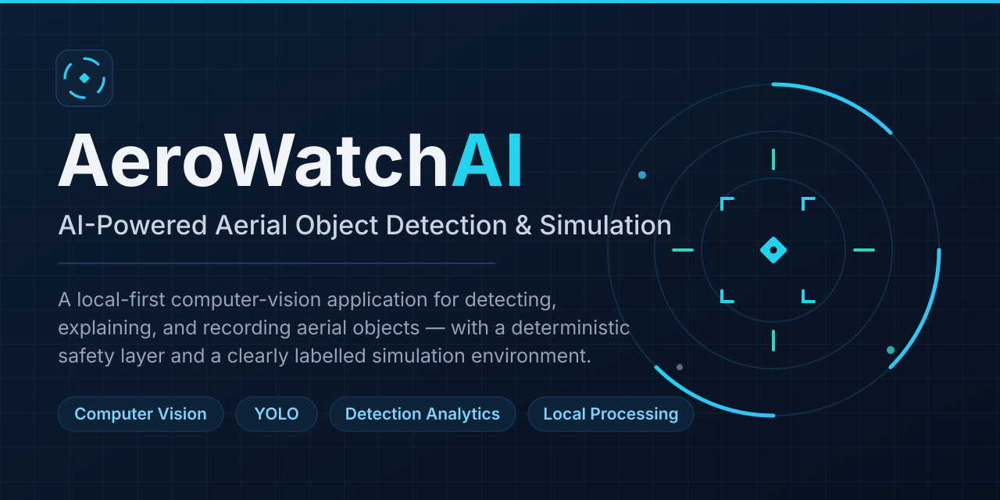

<div align="center">



# AeroWatchAI

**كشف الأجسام الجوية بالرؤية الحاسوبية والمحاكاة — يعمل محلياً بالكامل، بطبقة أمان حتمية، وقياسات صادقة.**

[English](README.md) · [دليل الإصدار النهائي](docs/FINAL_RELEASE_GUIDE.md) · [فهرس الوثائق](docs/README.md)

</div>

---

## ما هو AeroWatchAI؟

تطبيق **رؤية حاسوبية يعمل محلياً بالكامل** يكشف الأجسام الجوية — **الطائرات المسيّرة، والطائرات، والطيور، والبالونات** — في الصور والفيديو وإطارات الكاميرا، ويشرح كل تنبؤ، ويسجّل سجلاً محلياً قابلاً للبحث بكل ما عالجه.

يقوم المشروع على ثلاثة التزامات هندسية:

1. **طبقة أمان حتمية للذكاء الاصطناعي.** لا يصل خرج النموذج الخام إلى المستخدم دون ترشيح. كل كشف يُتحقق منه ويُطابَع قياسياً وتُزال تكراراته ويُسند إليه «موقف» (posture) بواسطة كود حتمي (`ai_safety.py`): الفئات المدنية غير عدائية مهما بلغت الثقة، والطائرة المسيّرة الواثقة تعني «يلزم تحقق المشغّل» — لا تهديداً مؤكداً أبداً — والاشتباك التلقائي مُعطَّل برمجياً بشكل دائم.
2. **قياس صادق.** أُعيد تقييم النموذج الرئيسي على مجموعة اختبار صغيرة مستقلة وموثّقة التراخيص (المرحلة 5). وحلّت نتائجه (mAP50 بقيمة **0.497**) محل الأرقام التسويقية السابقة للمشروع، والتي **سُحبت** لأنها لم تطابق أي قياس قابل للتكرار.
3. **تشغيل محلي أولاً.** لا سحابة، ولا واجهات ذكاء اصطناعي خارجية، و**لا نموذج لغوي (LLM) في النظام إطلاقاً**. السجل يخزّن بيانات وصفية فقط — لا صورك ولا فيديوهاتك ولا إطارات كاميرتك أبداً.

يتضمن التطبيق أيضاً **لعبة محاكاة اعتراض خيالية** تعمل في المتصفح. هي مكوّن منفصل، مُعلَّمة بوضوح بأنها محاكاة في كل مكان، وغير متصلة بأي مستشعر أو سلاح أو نظام تحكم ناري حقيقي.

## أبرز القدرات المنفَّذة

- كشف YOLO بأربع فئات قياسية (PyTorch افتراضياً، وONNX Runtime اختيارياً) مع مطابقة قياسية وإزالة التكرار بين الفئات.
- تحليل صور مع لوحة شرح لكل تنبؤ، ومعالجة فيديو بتقدّم وملخصات تجميعية، وجلسات كاميرا بدورة حياة كاملة (بدء/إيقاف) ومجاميع مسجلة.
- سجل كشوفات دائم (SQLite): بحث ومرشحات (فئة/ثقة/تاريخ)، وتعليم تحقق بشري، واحتفاظ وتقليم، ونسخ احتياطي واستعادة.
- لوحة معلومات وتحليلات محسوبة من السجل الحقيقي فقط، وتصدير CSV (محمي من حقن الصيغ) وJSON وتقارير Markdown — كلها تحمل إخلاء مسؤولية «تنبؤات غير مُتحقق منها».
- تشخيص عتاد، وأداة تحقق موحّدة للإصدار، ووضع عدم اتصال (`AEROWATCH_OFFLINE=1`)، وسكربتات إعداد وتشغيل لويندوز.

## التشغيل السريع (ويندوز)

```powershell
powershell -ExecutionPolicy Bypass -File setup_windows.ps1   # مرة واحدة: فحص Python وإنشاء البيئة وتثبيت التبعيات المثبتة وتشغيل الفحص المسبق
powershell -ExecutionPolicy Bypass -File launch_windows.ps1  # كل مرة → http://localhost:8501
```

التفاصيل ومسار GPU واستكشاف الأخطاء: [docs/WINDOWS_GUIDE.md](docs/WINDOWS_GUIDE.md).

## الأداء المقاس

**مجموعة اختبار مستقلة وموثّقة التراخيص** (المرحلة 5 — 46 صورة / 64 صندوق حقيقة أرضية من ويكيميديا كومنز، جُمّدت قبل أي ضبط):

| المقياس | القيمة |
|---|---|
| mAP50 | **0.497** |
| mAP50-95 | **0.363** |
| الدقة (Precision) عند 0.25 | 0.784 |
| الاستدعاء (Recall) عند 0.25 | 0.453 |
| F1 عند 0.25 | 0.574 |

الدقة المتوسطة لكل فئة (AP50): الطائرات 0.785 · المسيّرات 0.537 · الطيور 0.515 · **البالونات 0.151** — وكشف البالونات نقطة ضعف معروفة. هذه النتائج **استكشافية**: المجموعة صغيرة، ولا تثبت تعميماً واسعاً في العالم الحقيقي. الأرقام التسويقية السابقة **سُحبت**. المنهجية الكاملة: [docs/VERIFIED_DATASET_PHASE5.md](docs/VERIFIED_DATASET_PHASE5.md).

لا يُنفّذ التطبيق تتبعاً مستمراً للأجسام (لا معرّفات تتبع؛ الفيديو يستخدم كشفاً لكل إطار مع تنعيم لصناديق الإحاطة)، ولا يقدّر المسافات، ولا يتحكم في أي عتاد حقيقي عدا قراءة كاميرا محلية.

## الأمان والخصوصية

- كل تنبؤ هو **خرج نموذج غير مُتحقق منه**؛ درجات الثقة ليست يقيناً ولا احتمالات عدائية.
- الفئات المدنية (طائرة، طائر، بالون) **لا تُصنَّف عدائية أبداً** من طبقة الأمان، مهما بلغت الثقة.
- لعبة الاعتراض **محاكاة خيالية**؛ التطبيق لا يتحكم في أسلحة أو مستشعرات حقيقية.
- لا يوجد أي نموذج لغوي (يفرضه اختبار انحدار)؛ لا تغادر أي بيانات الجهاز؛ السجل بيانات وصفية فقط.
- التطبيق **بلا مصادقة** — شغّله محلياً أو خلف وكيل مصادقة/VPN فقط. النشر العام غير معتمد.

## حالة المشروع والترخيص

- **التحقق التقني:** ✅ مُتحقق تقنياً — 169 اختباراً، تقييم عقد 19/19، فحص متصفح حقيقي، تثبيت نظيف.
- **تحقق المالك:** ⏳ معلّق — قياس RTX 3050 وتشغيل كاميرا حقيقية وأول تنفيذ لسكربتات PowerShell تتم على جهاز المالك.
- **التوزيع:** ⛔ غير مُصفّى — الترخيص لم يُحسم.

**حالة الترخيص: غير محسومة.** يحمل المستودع ملف `LICENSE` بصيغة MIT، لكن مكوّن الكشف (Ultralytics) يُعلن **AGPL-3.0** في بياناته الوصفية، ونموذج الكشف الافتراضي دُرّب على بيانات غير موثّقة التراخيص. لذلك لا تُعرض شارة MIT. المسارات والآثار: [docs/LICENSING_DECISION.md](docs/LICENSING_DECISION.md).

---

<div align="center">
<sub><b>AeroWatchAI</b> · النسخة العربية موجزة؛ النسخة الإنجليزية هي المرجع الكامل · حالة الترخيص غير محسومة ولا يُدّعى أي تصريح تجاري · التنبؤات مخرجات نموذج غير مُتحقق منها</sub>
</div>
