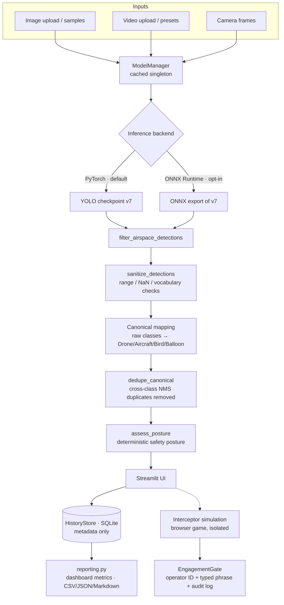

# AeroWatchAI — Architecture

The application is a single-process Streamlit app with a strict
one-way detection pipeline. Every model output passes through the
same deterministic safety path regardless of backend or input type.

## Component responsibilities

| Component | Responsibility |
|---|---|
| `app.py` | Streamlit UI: Dashboard, image/video/camera workflows, history & analytics pages, simulation page |
| `model_manager.py` | Checkpoint loading/validation (SHA-256), backend selection, the canonical detection filter pipeline |
| `ai_safety.py` | The safety contract: input validation, detection sanitising, posture assessment, engagement gate, audit log. Stdlib-only, independently testable |
| `onnx_backend.py` | ONNX Runtime wrapper exposing the same detection interface; feeds the identical filter path |
| `video_processor.py` | Per-frame video processing, box smoothing (not tracking), H.264 export, progress metrics |
| `camera_manager.py` / `camera_session.py` | Camera lifecycle (OpenCV) and per-session aggregate recording |
| `history_store.py` | SQLite persistence: sessions, prediction rows, aggregate counts, retention, backup/restore |
| `reporting.py` | Dashboard metrics and exports derived only from stored records |
| `interceptor_sim.py` | The fictional browser simulation game; isolated from detection except for the gated, allowlisted label hand-off |
| `preflight.py` / `release_validation.py` / `offline_guard.py` | Environment gating, unified release validation, opt-in offline enforcement |

## Invariants

- **One safety path.** PyTorch and ONNX outputs converge at
  `filter_airspace_detections`; no UI surface consumes raw model
  output.
- **Posture is deterministic.** Given (class, confidence,
  thresholds), `assess_posture` always returns the same result;
  `confirmed_hostile` and `auto_engage_allowed` are hard-coded
  `False`.
- **History is metadata.** No image/video/frame bytes, no full file
  paths (basenames only), no operator identifiers are stored.
- **Aggregates stay aggregates.** Video and camera sessions record
  per-class counts; individual rows exist only for predictions that
  were actually stored (image analyses).
- **No network at runtime.** No external APIs, no telemetry, no LLM
  (regression-tested). Offline mode can hard-block non-loopback
  sockets.
- **No tracking.** Detections are per-frame; the video box
  stabiliser smooths boxes geometrically and maintains no identities.

## Storage layout

- `runs/history/aerowatch_history.db` — detection history (SQLite,
  WAL; `AEROWATCH_HISTORY_DIR` overrides the location)
- `runs/` — model run outputs, engagement audit log (`JSONL`)
- `weights/` — checkpoints (v7 default; SHA-256 verified at load)
- `data/verified_v1/` — the license-verified evaluation dataset
  with per-file provenance manifest
